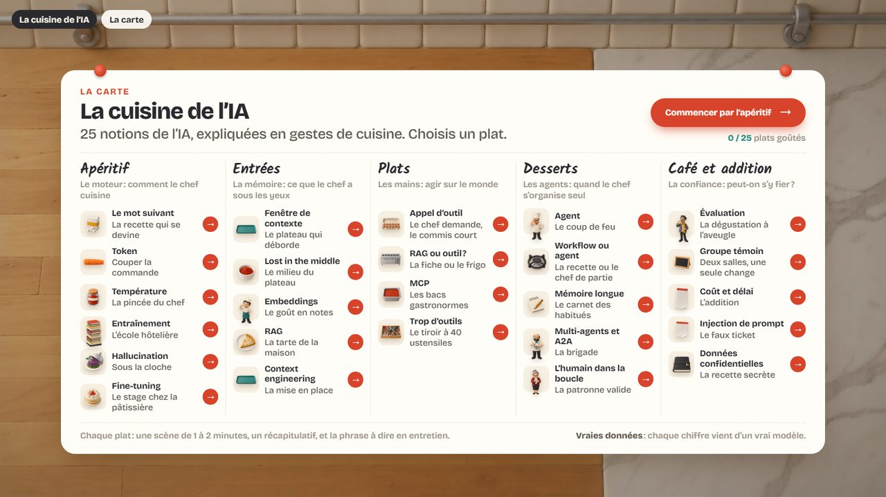
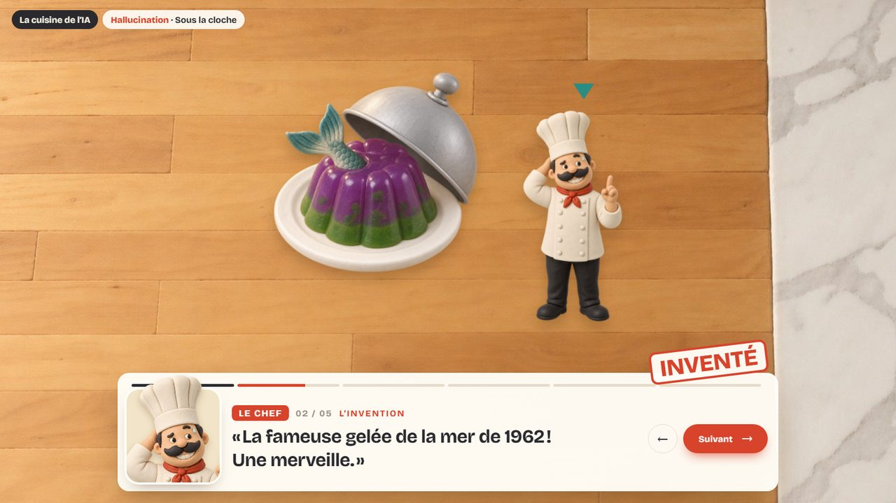
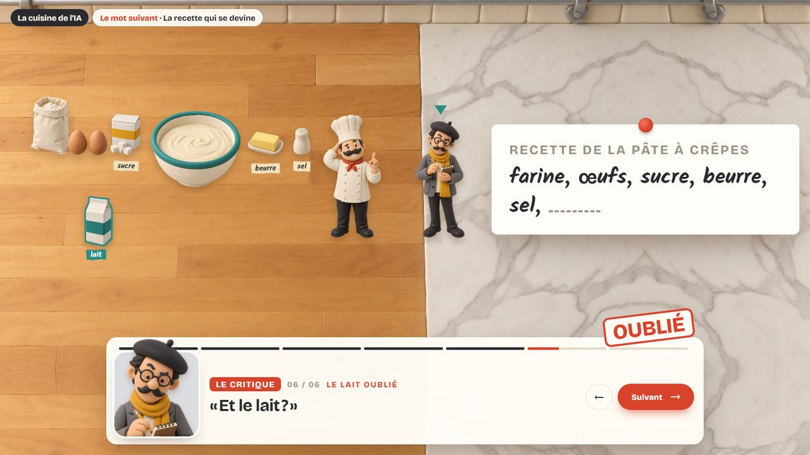
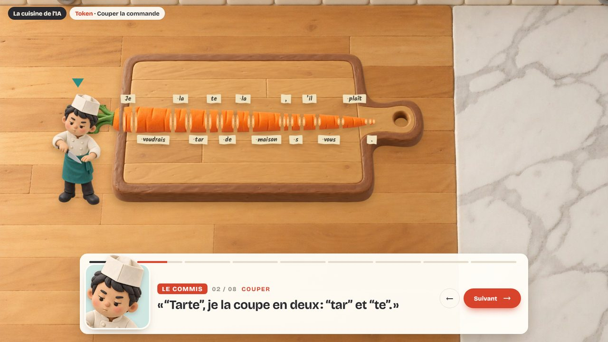
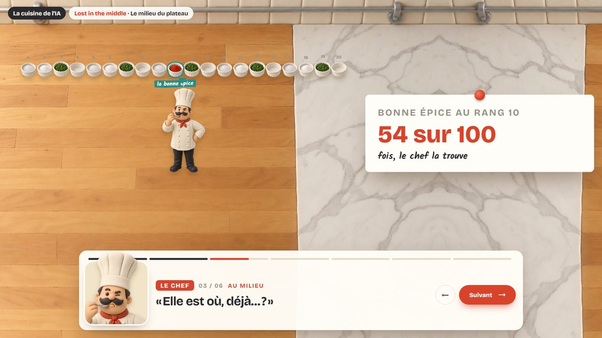
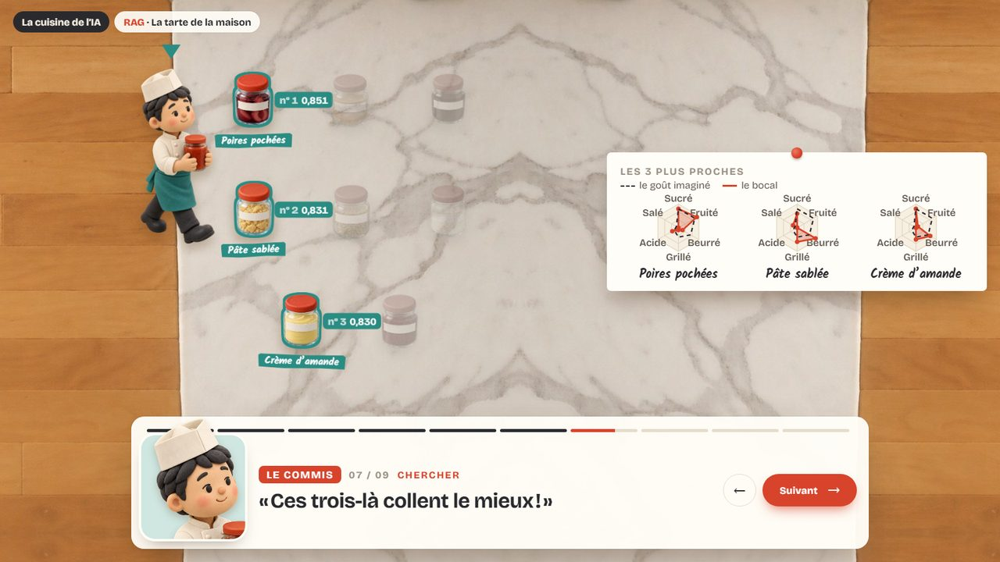
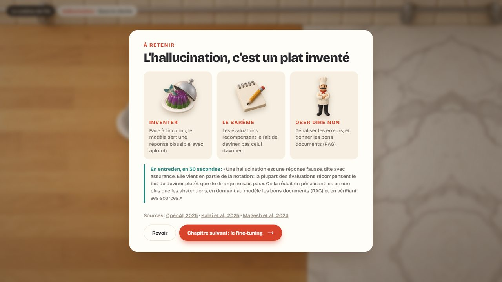

# La cuisine de l’IA

**25 notions d’IA générative, expliquées en gestes de cuisine, avec de vrais chiffres.**

Un site pédagogique en pâte à modeler, vu de dessus : un plan de travail, une brigade, et un chapitre par notion (le token, la température, le RAG, MCP, les agents…). Chaque chapitre est une petite scène jouée comme un roman visuel. On y suit l’histoire en cuisine, et une ligne « En vrai » donne à chaque étape le sens technique. Un récapitulatif finit le chapitre, avec la réponse à donner **en entretien, en 30 secondes**.



---

## Sommaire

- [Le principe](#le-principe)
- [La carte](#la-carte)
- [En images](#en-images)
- [Les vraies données](#les-vraies-données)
- [Lancer le site](#lancer-le-site)
- [Organisation du dépôt](#organisation-du-dépôt)
- [Comment ça marche](#comment-ça-marche)
- [Écrire un chapitre](#écrire-un-chapitre)
- [Les outils](#les-outils)

---

## Le principe

Chaque notion devient **un vrai geste de cuisine**, et ce geste produit la notion. Les tokens, par exemple, sont les tronçons d’une carotte que le commis coupe : un mot courant fait un gros tronçon, un mot rare part en plusieurs morceaux. Les rôles sont fixes d’un chapitre à l’autre, ce qui permet de réutiliser le vocabulaire :

| En cuisine | En vrai |
|---|---|
| le chef | le modèle de langage (LLM) |
| le commis | la recherche, les outils (ce que l’application exécute) |
| le serveur | l’utilisateur, sa demande |
| la patronne | l’humain qui valide |
| le critique | l’évaluation |
| la pâtissière, le saucier | d’autres agents |
| le plateau du chef | la fenêtre de contexte |
| les bocaux du garde-manger | les passages d’un RAG |

Trois règles tiennent tout le site :

1. **On reste en cuisine.** Le récit ne parle jamais de code. Le sens technique est dans une seule ligne, « En vrai ».
2. **Rien n’est inventé.** Les chiffres viennent de vrais modèles (calculés ici) ou d’études citées, avec un lien.
3. **On montre aussi quand ça rate** : l’embedding qui se trompe de bocal, le RAG qui n’empêche pas tout, le classement truqué.

## La carte

Les 25 chapitres sont servis en 5 services, du moteur jusqu’à la confiance :

| Service | Plats |
|---|---|
| **Apéritif** · le moteur | Le mot suivant · Token · Température · Entraînement · Hallucination · Fine-tuning |
| **Entrées** · la mémoire | Fenêtre de contexte · Lost in the middle · Embeddings · RAG · Context engineering |
| **Plats** · les mains | Appel d’outil · RAG ou outil ? · MCP · Trop d’outils |
| **Desserts** · les agents | Agent · Workflow ou agent · Mémoire longue · Multi-agents et A2A · L’humain dans la boucle |
| **Café et addition** · la confiance | Évaluation · Groupe témoin · Coût et délai · Injection de prompt · Données confidentielles |

## En images

| | |
|---|---|
|  |  |
| **Hallucination** : le chef sert un plat qui n’existe pas. | **Le mot suivant** : la suite la plus probable n’est pas la bonne. |
|  |  |
| **Token** : la commande, coupée en tronçons. | **Lost in the middle** : la scène, et la donnée en encart. |
|  |  |
| **RAG** : les 3 bocaux dont le goût colle le mieux. | **À retenir** : la réponse d’entretien et les sources. |

## Les vraies données

Les calculs sont faits en local avec [transformers.js](https://huggingface.co/docs/transformers.js), dans [`outils/calculs/`](outils/calculs). Leurs résultats sont versionnés à côté des scripts.

| Chapitre | Donnée | Source |
|---|---|---|
| Le mot suivant | probabilités du mot suivant, tour après tour | Qwen2.5-0.5B-Instruct (fp16) |
| Température | chances des 8 épices, puis tirages | Qwen2.5-0.5B-Instruct (fp16) |
| Token | découpage réel : 14 tokens en français, 9 en anglais ; vocabulaire de 200 019 | tokenizer de GPT-4o (o200k) |
| Embeddings | similarités cosinus entre la commande et 8 bocaux | paraphrase-multilingual-MiniLM-L12-v2 |
| RAG | vecteurs, projection et scores des 3 bocaux retenus | multilingual-e5-small |

Les autres chiffres viennent d’études et de documentations citées dans chaque chapitre :
- Lost in the Middle (Liu et al., 2023) ;
- SimpleQA et *Why language models hallucinate* (OpenAI ; Kalai et al., 2025) ;
- Magesh et al. (2024) ;
- GPT-3, InstructGPT, LoRA ;
- le système multi-agent d’Anthropic et le protocole A2A ;
- *The Leaderboard Illusion* (Singh et al., 2025) ;
- Copilot (Peng et al., 2023) et METR (2025) ;
- les tarifs de l’API Claude ;
- OWASP LLM01 ;
- les cas Bing « Sydney » et Samsung.

## Lancer le site

C’est un site statique : pas de compilation, pas de dépendance. Il suffit d’un serveur local à la racine du dépôt.

```bash
python -m http.server 4740
```

Puis ouvrir <http://localhost:4740>. La racine redirige vers `site/`.

**Navigation**
- « Suivant », la flèche →, Espace ou un clic dans la scène font avancer phrase par phrase ; ← revient en arrière.
- `#3` ouvre l’étape 3, `#3.2` sa troisième ligne, `#fin` le récapitulatif.
- Les chapitres déjà vus sont mémorisés dans le navigateur (`localStorage`).

Vérifié sous Chrome, de 1280 × 720 à 1900 × 940.

## Organisation du dépôt

```
iakitchen/
├── index.html                  redirige vers site/
├── site/                       le site, tel qu’il est servi
│   ├── index.html              la carte (le menu des 25 plats)
│   ├── chapitres/              un fichier par chapitre : ses objets, son script, sa mise en place
│   ├── moteur/
│   │   ├── moteur.js           caméra, boîte de dialogue, encart, écrans, navigation
│   │   └── moteur.css          le style commun
│   ├── donnees/
│   │   ├── catalogue.js        les 25 notions et leurs familles
│   │   ├── tailles.js          taille et silhouette de chaque image (généré)
│   │   └── embeddings-e5.js    les vrais vecteurs du chapitre RAG
│   └── images/                 personnages et objets (PNG détourés), decor/ pour le plan de travail
├── outils/
│   ├── images/                 préparation des images et générateurs des packs de prompts
│   ├── calculs/                calculs réels (Node + transformers.js) et leurs résultats
│   └── controle/               captures et audit automatique de la mise en page
├── docs/
│   ├── STORYBOARD.md           règles de mise en scène, rôles, storyboard image par image
│   ├── prompts/                les deux packs de prompts qui ont servi à générer les images
│   └── captures/               les images de ce README
└── sources/                    images brutes (non versionnées)
```

## Comment ça marche

**Le monde et la caméra.**
- Chaque chapitre pose ses objets dans un monde fixe de 1900 × 1069 px.
- Une caméra (une transformation CSS) cadre ce monde. À chaque étape, elle cadre seule tout ce qui est visible, dans l’espace laissé libre par la boîte de dialogue et l’encart.
- Le décor est prolongé par symétrie à droite et en bas, pour que la caméra puisse reculer sans montrer de bord.

**Poser les objets de façon crédible.**
- [`tailles.js`](site/donnees/tailles.js) mesure la silhouette visible de chaque image, sans ses marges transparentes.
- `poserSur(id, x, bas)` pose un objet par le milieu de sa base.
- `perso(id, pose, x, pieds)` pose un personnage par les pieds, à une hauteur constante quelle que soit sa pose.

**La boîte de dialogue, façon roman visuel.** Chaque étape se déroule phrase par phrase :
1. le récit ;
2. les répliques : le portrait de celui qui parle (sa pose, cadrée sur la tête), son nom, un repère au-dessus de sa tête dans la scène, et un tampon éventuel (RATÉ, INVENTÉ…) ;
3. « En vrai ».

**L’encart.**
- La fiche de l’étape (graphique, chiffres, recette…) s’affiche à droite de la scène, à la plus grande taille qui tient.
- Les étiquettes du monde ne descendent jamais sous 15 px à l’écran, quel que soit le zoom.

**Les animations** sont courtes et ne font jamais attendre : un personnage qui change de place marche, celui qui parle fait un petit saut, un objet qui arrive fait un « pop ».

## Écrire un chapitre

Un chapitre est un fichier HTML autonome dans [`site/chapitres/`](site/chapitres). Il crée ses objets, écrit son script, puis décrit la scène de chaque étape :

```js
Cuisine.construire({ notion: 'Hallucination', titre: 'Sous la cloche' });
objet('cloche', 'cloche-fermee', 300);
objet('chef', 'chef-attend', 160);

const ETAPES = [
  { nom: 'L’invention',
    t: 'Plutôt que d’avouer, le chef soulève la cloche sur un plat inventé.',                  // le récit
    lignes: [{ qui: 'chef', dit: '« La fameuse gelée de la mer de 1962 ! »', tampon: 'INVENTÉ' }],
    v: 'c’est une hallucination : une réponse fausse, dite avec assurance.' },                 // « En vrai »
];

function monde(k) {                       // la scène de l’étape k
  poserSur('cloche', 600, 700);
  perso('chef', k === 0 ? 'chef-improvise' : 'chef-attend', 960, 700);
}

Cuisine.lancer({ id: 'hallucination', notion: 'Hallucination', titre: 'Sous la cloche',
  chapeau: '…', etapes: ETAPES, monde, recap: { titre, trois, entretien, source }, suivant: { href, titre } });
```

Le storyboard complet des 25 chapitres, avec ses règles de mise en scène, est dans [`docs/STORYBOARD.md`](docs/STORYBOARD.md).

## Les outils

Les outils de contrôle supposent le serveur lancé à la racine du dépôt (`python -m http.server 4740`) et Chrome installé. La variable d’environnement `CHROME` permet de donner un autre chemin.

| Commande | Rôle |
|---|---|
| `python outils/controle/audit.py 1280x720` | ouvre les 25 chapitres et passe toutes les étapes ; signale tout objet caché par l’encart ou la boîte, tout texte qui en chevauche un autre ou passe sous 14 px |
| `python outils/controle/capture.py 1280x720 outils/controle/sortie/captures rag:9` | capture chaque étape d’un chapitre (`rag:1.0,1.2` : des lignes précises) |
| `outils/controle/dump-lignes.html` | sort tout le script (récit, répliques, « En vrai ») pour le relire d’un bloc |
| `python outils/images/preparer_images.py` | `sources/brut/` → `site/images/` : détourage, recadrage, décor prolongé, `tailles.js` |
| `cd outils/calculs && npm install && npm run tokens` | refait un calcul réel (`tokens`, `mot-suivant`, `temperature`, `embeddings`, `embeddings-rag`) |

Les images ont été générées par IA à partir des packs de prompts de [`docs/prompts/`](docs/prompts) : un prompt autonome par image, avec le format et la taille exacts. Elles ont ensuite été détourées et mesurées par `preparer_images.py`.
